# elHydro

[](https://github.com/Elia31/elHydro/actions/workflows/ci.yml)

**Energieeffizientes IoT-Bewässerungssystem mit ESP32-C6** · [English summary](#english-summary)

Ein batteriebetriebener Sensorknoten misst Bodenfeuchte, Temperatur und Luftfeuchte, gießt die Pflanze bei Bedarf und ist über 99 % der Zeit im Deep Sleep. Wann er das nächste Mal aufwacht und ob gegossen wird, entscheidet eine Python-Anwendung auf einem PC oder Raspberry Pi in Bluetooth-Reichweite, dem *Host*. Grundlage sind Trocknungsverlauf, Pflanzentyp und Wetterprognose. Eine Cloud braucht es dafür nicht.

<p align="center">
  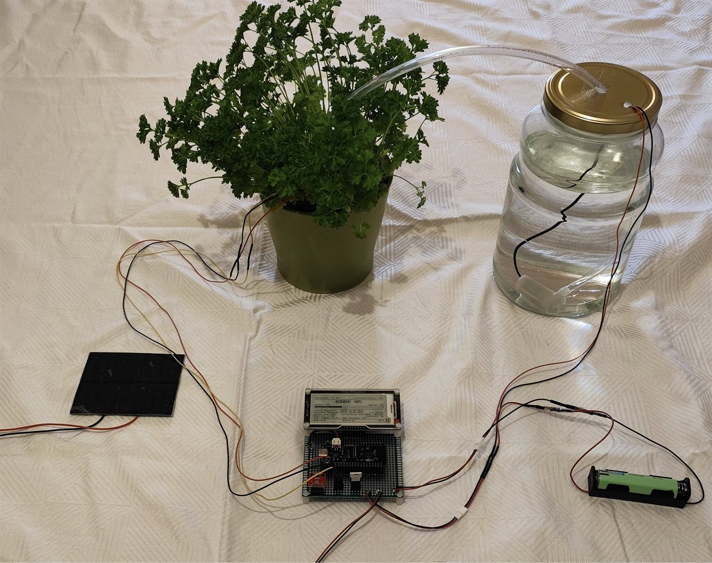
</p>

## Funktionen

- Im Deep Sleep braucht der Knoten unter 20 µA. Mit einer 18650-Zelle hält er je nach Messintervall rechnerisch knapp ein halbes Jahr bis etwa drei Jahre durch, ein kleines Solarpanel kann zusätzlich nachladen.
- Die Entscheidungslogik auf dem Host (im Code „Brain“) legt anhand von Trocknungsrate, Pflanzentyp, Temperatur und bei Outdoor-Pflanzen der Wetterprognose von [Open-Meteo](https://open-meteo.com/) fest, wann wieder gemessen und ob gegossen wird. Bei Frost oder angesagtem Regen wird nicht gegossen.
- Ist der Host nicht erreichbar, misst und gießt der Knoten selbstständig weiter und liefert die gepufferten Messungen beim nächsten Kontakt nach.
- Ein E-Paper-Display zeigt die wichtigsten Werte direkt an der Pflanze an, auch ohne Verbindung zum Host. Die Treiber für Schwarz/Weiß-, Schwarz/Weiß/Rot- und Vier-Farben-Panels sind selbst geschrieben.
- Das Web-Dashboard zeigt Live-Werte und Verlauf aller Pflanzen, exportiert die Daten als CSV oder Excel und lässt sich per QR-Code auch auf dem Handy öffnen.
- Das Material für einen Knoten kostet unter 40 €.

## Architektur

<p align="center">
  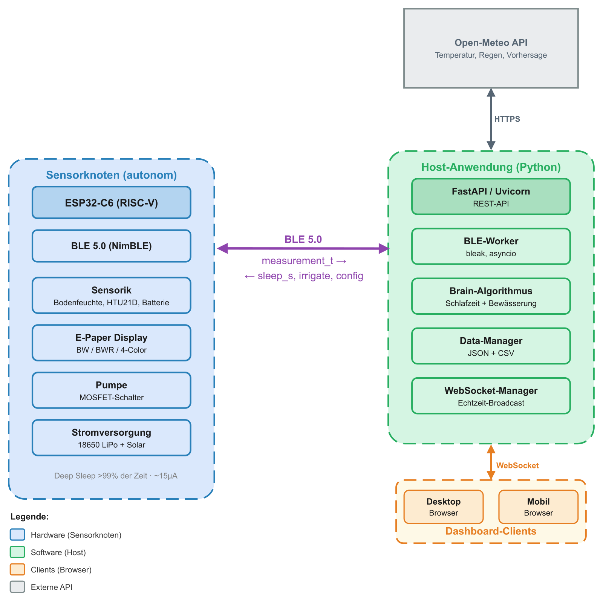
</p>

| Teil | Ordner | Technik |
|---|---|---|
| Sensorknoten | [`firmware/`](firmware/) | C, ESP-IDF 5.5, FreeRTOS, NimBLE · ESP32-C6 (DFRobot FireBeetle 2), HTU21D (I²C), kapazitiver Bodenfeuchtesensor (ADC), Pumpe über MOSFET, E-Paper (SPI) |
| Host-Anwendung | [`webapp/`](webapp/) | Python 3.10+, FastAPI, Uvicorn, Bleak, asyncio, WebSockets · Dashboard in HTML, CSS und JavaScript · Launcher mit Tkinter, mDNS (Zeroconf) und System Tray |

### Sensorknoten

Nach jedem Aufwachen durchläuft die Firmware einen Zustandsautomaten: messen, per Bluetooth Low Energy (BLE) senden, bei Bedarf gießen, Display aktualisieren und wieder schlafen. Sensoren und Display bekommen nur Strom, wenn sie gebraucht werden.

<p align="center">
  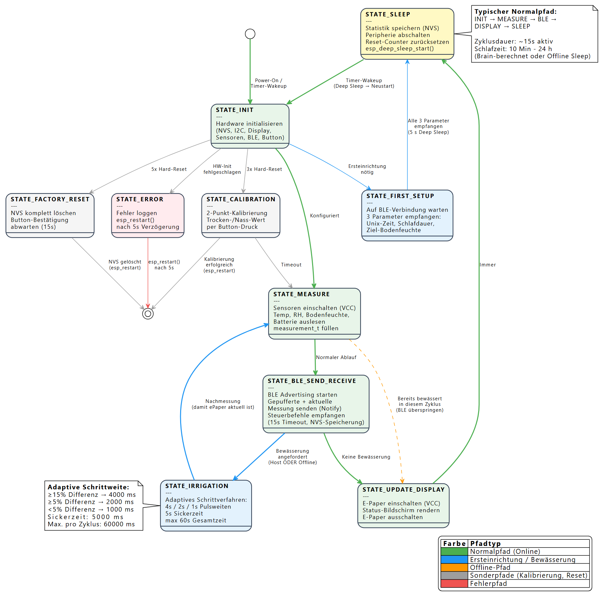
</p>

<p align="center">
  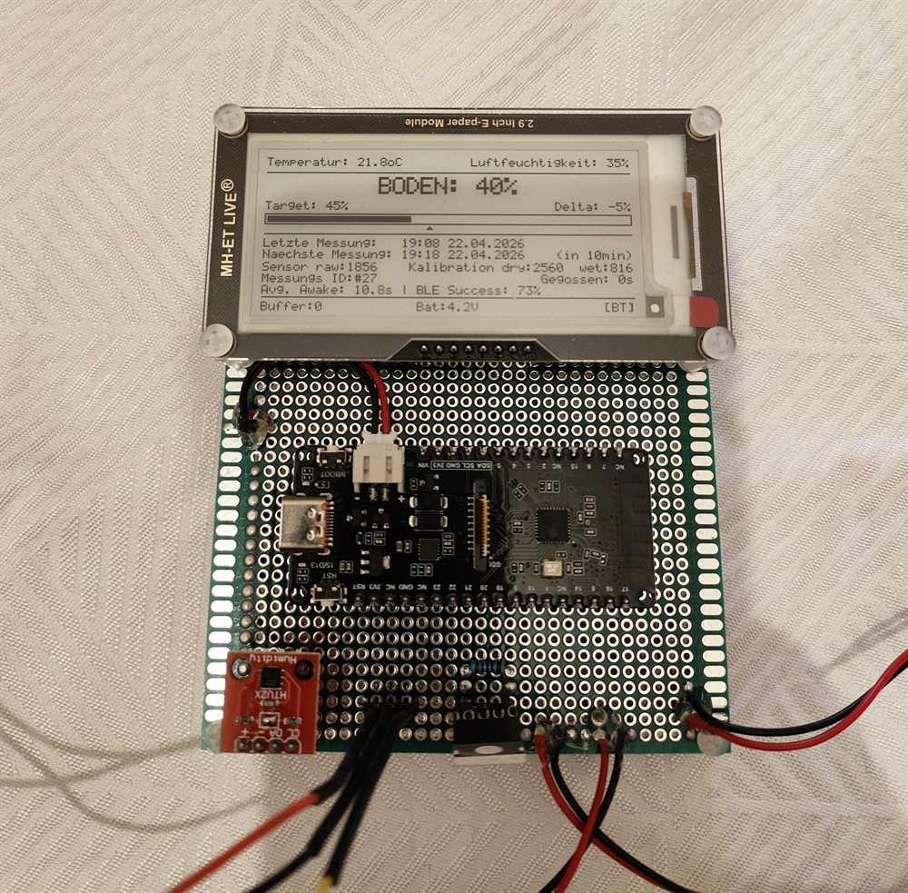
  &nbsp;
  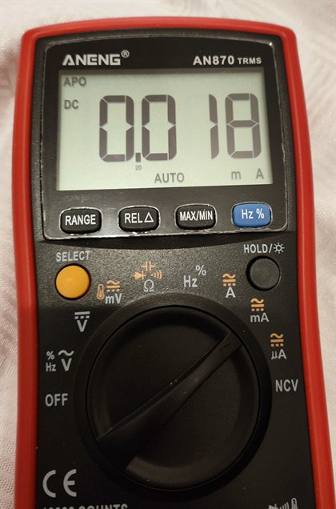
  <br><em>Sensorknoten mit 2,9-Zoll-E-Paper und Strommessung im Deep Sleep (0,018 mA = 18 µA)</em>
</p>

<p align="center">
  <picture>
    <source media="(prefers-color-scheme: dark)" srcset="docs/bilder/batterie_verlauf_dunkel.png">
    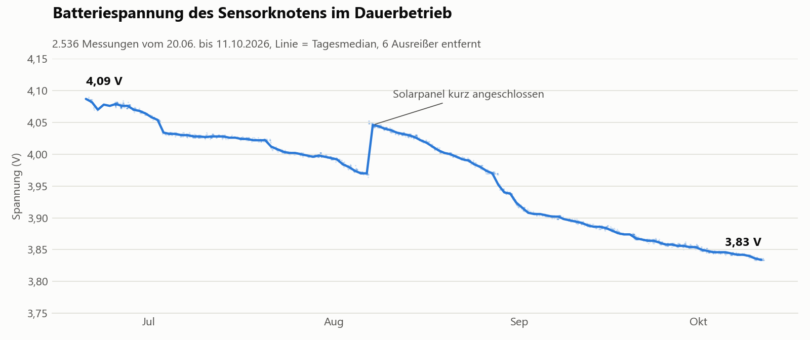
  </picture>
  <br><em>Batteriespannung meines Knotens im Dauerbetrieb (18650-Zelle, etwa eine Messung pro Stunde). In knapp vier Monaten ist die Spannung nur von 4,09 V auf 3,83 V gesunken, der Sprung Anfang August kommt vom Solarpanel.</em>
</p>

### Host-Anwendung

Der Host wertet jede Messung aus und schickt dem Knoten die nächste Schlafdauer und die Bewässerungsentscheidung zurück. Als Host reicht ein Windows- oder Linux-Rechner mit Bluetooth in Reichweite des Knotens; bei mir ist das seit Monaten ein Raspberry Pi Zero 2 W ohne Bildschirm. Das Dashboard hat keine Anmeldung und ist deshalb nur für das eigene Heimnetz gedacht.

<p align="center">
  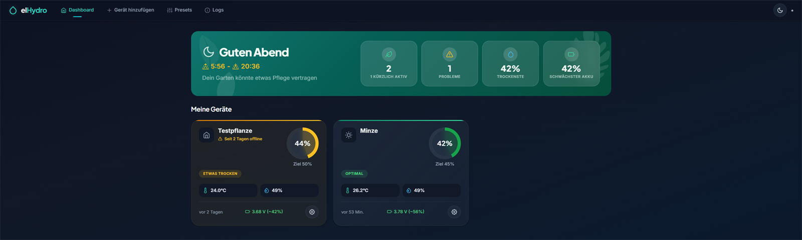
  <br><em>Das Web-Dashboard</em>
</p>

<p align="center">
  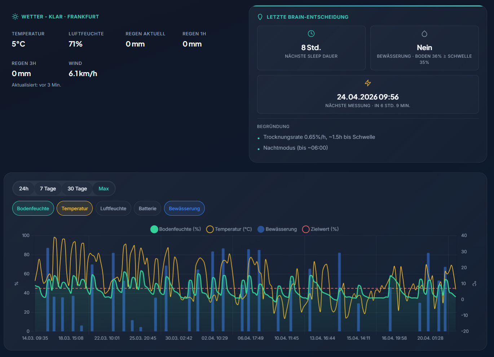
  <br><em>Detailansicht mit Wetter, Brain-Entscheidung und Messverlauf</em>
</p>

<p align="center">
  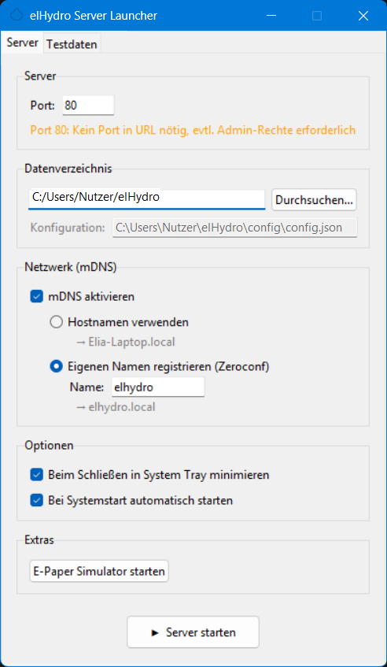
  &nbsp;
  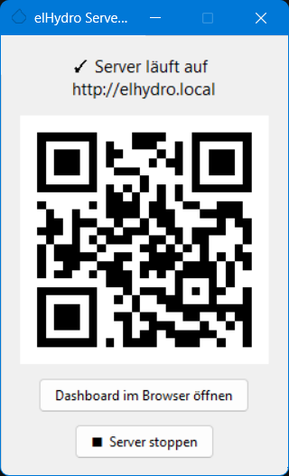
  <br><em>Desktop-Launcher mit QR-Code fürs Handy</em>
</p>

## Host-Anwendung starten

Unter Windows reicht die `elHydro.exe` aus den [Releases](https://github.com/Elia31/elHydro/releases), Python ist dafür nicht nötig. Mit Python 3.10 oder neuer läuft die Anwendung unter Windows und Linux:

```bash
git clone https://github.com/Elia31/elHydro.git
cd elHydro/webapp
python -m venv .venv
# Windows: .venv\Scripts\activate    Linux: source .venv/bin/activate
pip install -r requirements.txt
python launcher.py
```

Im Launcher startet ein Klick auf „Server starten“ den Server, danach zeigt der Launcher die Adresse des Dashboards und einen QR-Code fürs Handy. Ohne Bildschirm, z. B. auf einem Raspberry Pi, startet `python main.py` nur den Server. Optionen wie Port und Datenordner, die nötigen Linux-Pakete und den Dauerbetrieb als systemd-Dienst beschreibt die [Anleitung zur Host-Anwendung](docs/desktopanwendung.md).

### Ohne Hardware ausprobieren

Für einen ersten Eindruck braucht es weder Sensorknoten noch Bluetooth: Im Launcher unter „Testdaten“ Messverläufe erzeugen, den Server starten und das Dashboard öffnen. Ohne Launcher erzeugt `python tools/generate_dummy_data.py` dieselben Testdaten. Im Launcher unter „Extras“ startet der E-Paper-Simulator, der die Anzeige des Knotens nachbildet.

<p align="center">
  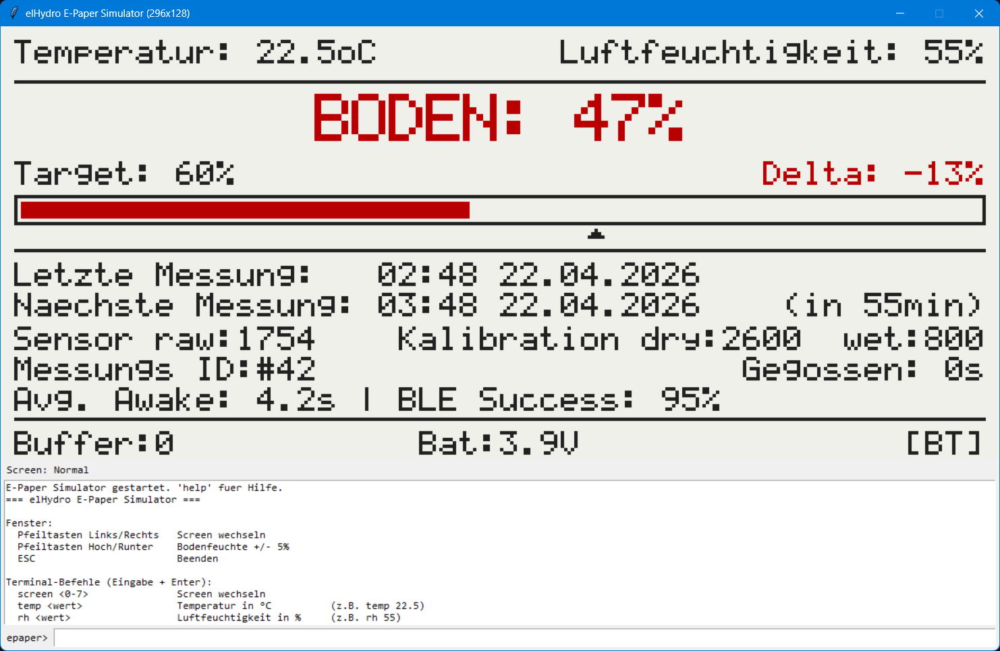
  <br><em>Der E-Paper-Simulator (Vier-Farben-Variante)</em>
</p>

## Sensorknoten bauen und flashen

Teileliste, Verkabelung, Flashen und Einrichtung stehen in der [Anleitung zum Sensorknoten](docs/sensorknoten.md). Vor dem Kompilieren der Firmware in `firmware/main/config.h` Display-Variante, Sensortyp und Zeitzone prüfen und in `firmware/main/pins.h` die Pinbelegung. Mit ESP-IDF 5.5:

```bash
cd firmware
idf.py set-target esp32c6
idf.py build flash monitor
```

## Bachelorarbeit

elHydro ist 2026 als meine Bachelorarbeit entstanden: „Entwicklung eines energieeffizienten IoT-Bewässerungssystems mit hostbasierter, kontextsensitiver Schlaf- und Bewässerungssteuerung“. Untersucht habe ich, ob ein batteriebetriebener Knoten mit einer Steuerung auf einem lokalen Host über Monate autonom laufen kann. Laut Strommessung reicht eine 18650-Zelle selbst bei einer Messung alle 30 Minuten rechnerisch für 171 Tage, bei Messintervallen von einer bis vier Stunden für etwa elf Monate bis drei Jahre.

## English summary

elHydro is a low-power IoT irrigation system built around an ESP32-C6. A battery-powered sensor node measures soil moisture, temperature and humidity, waters the plant when needed and spends more than 99 % of its time in deep sleep (below 20 µA). A Python application on a local PC or Raspberry Pi receives the measurements via Bluetooth LE and decides when the node wakes up next and whether to water, based on the drying rate, the plant type and, for outdoor plants, the weather forecast. No cloud is involved. If the host is out of reach, the node keeps working on its own and sends the buffered data later. An e-paper display shows the key values at the plant, and a web dashboard shows live values and history.

The project was my bachelor's thesis in 2026. Based on the measured current draw, one 18650 cell lasts roughly eleven months to three years at one measurement every one to four hours.

The guides and code comments are in German. To try the host application without hardware, start the launcher (`elHydro.exe` from the [releases](https://github.com/Elia31/elHydro/releases) on Windows, or `python launcher.py` as shown [above](#host-anwendung-starten)) and generate test data.

## Lizenz

elHydro steht unter der GPL-3.0, siehe [LICENSE](LICENSE). Wer elHydro verändert und weitergibt, muss das Ergebnis ebenfalls unter der GPL-3.0 und mit Quellcode weitergeben. Mitgelieferte Fremdbestandteile behalten ihre eigenen Lizenzen.
